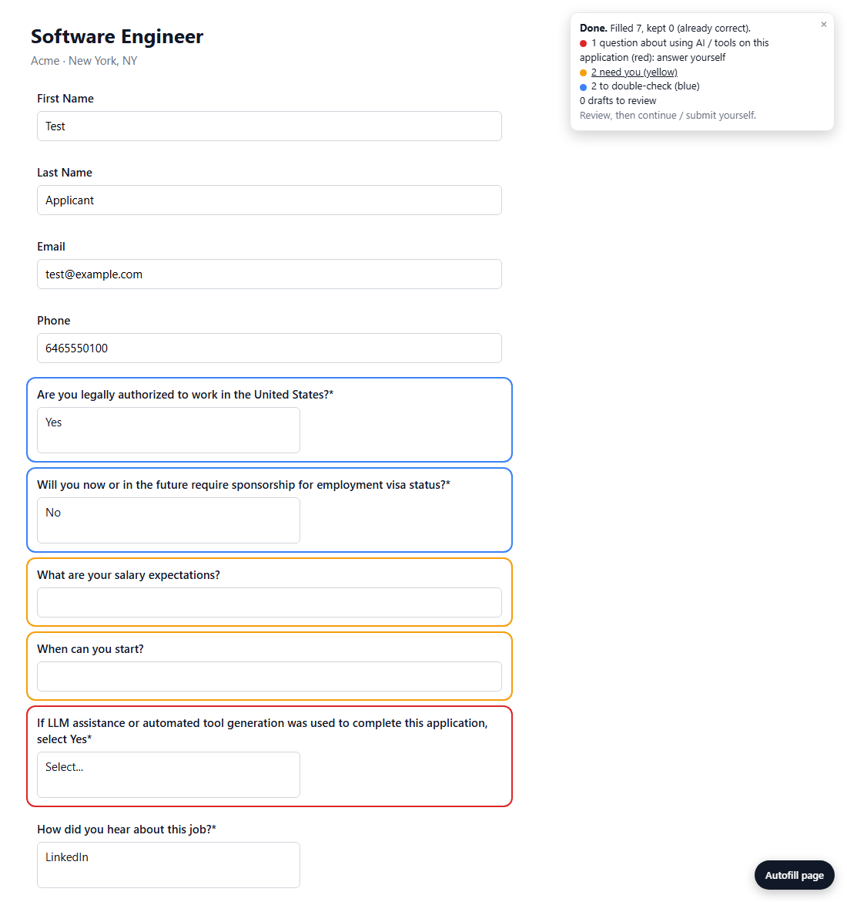

# Application Autofill

A Chrome extension (Manifest V3) that fills job applications from a profile you keep in its Options page. Fixed facts (contact details, education, work history, work authorization) are filled by rules; questions no rule answers go to Claude only when it's allowed to answer them; open-ended questions get a draft for you to edit. Every field it touches is outlined so you can review it, and it never submits anything.



*Screenshot of a test fixture with fake data.*

- **Blue**: answered by a rule or by Claude; double-check it. Plain profile fields (name, email, phone) are filled without an outline.
- **Yellow**: needs you (no rule or setting answers it, or it's yours by design: pay, start date, EEO you left blank, attestations).
- **Red**: a question about using AI on this application, or a possible AI-detection trap; answer it (or leave it) yourself.

## Supported portals
Workday, Greenhouse, Ashby, Lever, Gem, iCIMS, Rippling, and YC Work at a Startup (drafts the note to the founder only). Forms embedded on a company's own careers page (an iframe) are filled too. How well each portal works depends on how much real-page testing it has had: Workday, Greenhouse and Ashby have run on many real postings; Lever, Gem and iCIMS on a few; Rippling and YC Work at a Startup are built from captured markup and haven't been run on a live posting yet.

## Install
1. Download or clone this repository.
2. Open `chrome://extensions` and turn on **Developer mode** (top right).
3. **Load unpacked** and pick the repository folder.
4. Pin the extension, then right-click its icon and open **Options**.

There is no build step: after pulling changes, click the reload icon on the extension's card.

## Setup
1. **Bring your own Anthropic API key.** Paste it in Options (Claude section). The extension calls the Anthropic API directly with your key; nothing goes through any other server. Without a key, rules still fill everything they can and the rest stays yellow.
2. **Fill your profile in Options**: contact details, work experience, education (with the degree wordings and school aliases portals use), work authorization and the other fixed answers, how you heard about jobs, office locations you can commute to, optional EEO answers, and the materials drafts are written from (resume text, LinkedIn text, notes, projects to highlight). Upload your resume file for upload fields.
3. Export a backup from Options once in a while. The data lives in the browser profile of this unpacked extension; moving the extension folder changes its ID and its storage.

## Use
On an application page, click the floating **Autofill page** button, the toolbar popup's **Fill this page**, or press **Alt+Shift+F** (change it at `chrome://extensions/shortcuts`). For a form embedded in a company's site there is no floating button: use the popup or the shortcut. The toolbar badge shows progress, then the number of fields that need you. A **Stop** button appears while it runs.

## How it decides
1. **Profile and rules first.** Contact fields, education, work history, and a long list of fixed-answer rules (work authorization, sponsorship, age, relocation and office attendance from the job's location, clearance, how you heard, graduation dates, ...) answer from your Options. A rule that matches either answers or leaves the field yellow and says why in the console; it never hands the question on silently.
2. **Learned answers.** When you answer a yellow question yourself, it's saved (pending your review in Options) and reused for the same question later.
3. **Classifier, then answers (Claude Haiku).** Questions no rule answered are first sorted into categories; most categories go back to their rules or stay yours, and only "other" questions are sent for an answer. An answer is used only above a confidence threshold (0.75 by default, adjustable).
4. **Drafts (Claude Sonnet).** Open-ended questions ("Why this company?", "Tell us about a project") get a short first-person draft written from your own materials and the job description, outlined blue for you to edit. Turn drafts off in the popup.

Models are set in Options.

## Guardrails
- **Never submits or navigates.** It never clicks Submit, Next, Save and Continue, Apply, Back or any page-level control; you review and submit.
- **Some questions never go to Claude:** legal attestations and signatures, EEO / demographic questions (only your Options answers fill them), compensation, start date and availability, notice period, relationships and conflicts of interest, accommodations, and questions about using AI / tools on the application (outlined red for you).
- **Forms that forbid AI-written answers** (an AI-use policy, "your own original writing") get no drafts.
- **Experience claims need a quote.** A "Do you have experience with X?" is answered Yes only when Claude cites a verbatim quote from your resume, LinkedIn text or notes, and the extension checks the quote is really there; anything else stays yellow.
- **Page text is data, not instructions.** Questions, options and job descriptions are sent inside clearly marked data blocks, hidden instructions planted in a page are flagged (red) and never followed, and replies that talk like an AI are discarded.
- **Learned answers are scoped and reviewed.** Answers that name a company are reused only for that company; new answers wait in Options "Pending review" until you approve them; whole categories (pay, availability, EEO, attestations, AI-usage disclosures, ...) are never learned.

## Privacy
Your profile, resume file, settings and learned answers stay in the browser's extension storage (`chrome.storage.local`) on your machine. The only data that leaves it goes to the Anthropic API, with your key, when Claude is used: the text of the questions (and their options) being asked, the job description, and the materials you chose to provide for drafts (profile summary, resume text, LinkedIn text, notes). Nothing is sent anywhere else, and there is no telemetry.

## Running the tests
The tests are fake portal pages (`tests/fixtures/`, fake data only) filled in headless Microsoft Edge, with a before / after comparison against the last commit and a corpus of expected answers (`tests/expected.txt`). On Windows:

```powershell
powershell -ExecutionPolicy Bypass -File tests\run.ps1              # every fixture vs the last commit
powershell -ExecutionPolicy Bypass -File tests\run.ps1 -Only ashby  # fixtures starting with "ashby"
```

`tests/bg-request.js` (Node, run by `run.ps1`) checks the Claude request bodies. A privacy check (`tests/privacy-check.js`) refuses personal data listed in your own git-ignored `tests/private-patterns.txt`; after cloning, enable the pre-commit hook that runs it:

```
git config core.hooksPath tests/hooks
```

`CLAUDE.md` holds the detailed design notes: every rule, why it exists, and the fixture that covers it.

## Limitations
- Not affiliated with, endorsed by, or supported by Workday, Greenhouse, Ashby, Lever, Gem, iCIMS, Rippling, Y Combinator or Anthropic.
- Portals change their markup; a field can be missed or filled wrong. You review every answer before submitting: the outlines show what was filled and what needs you.
- Using Claude costs API credits on your Anthropic account (a few small Haiku calls per page that has unanswered questions, plus one Sonnet call when there are drafts).
- Chrome / Chromium only, loaded unpacked.

## License
MIT; see [LICENSE](LICENSE).
